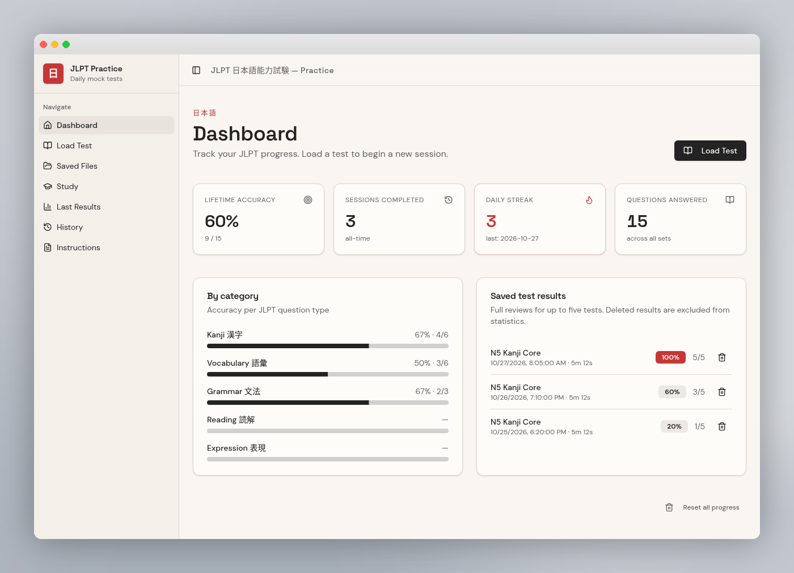
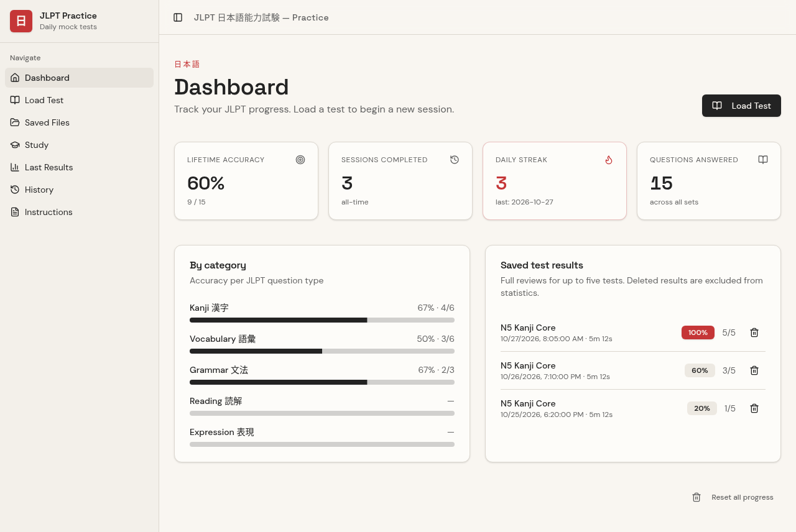
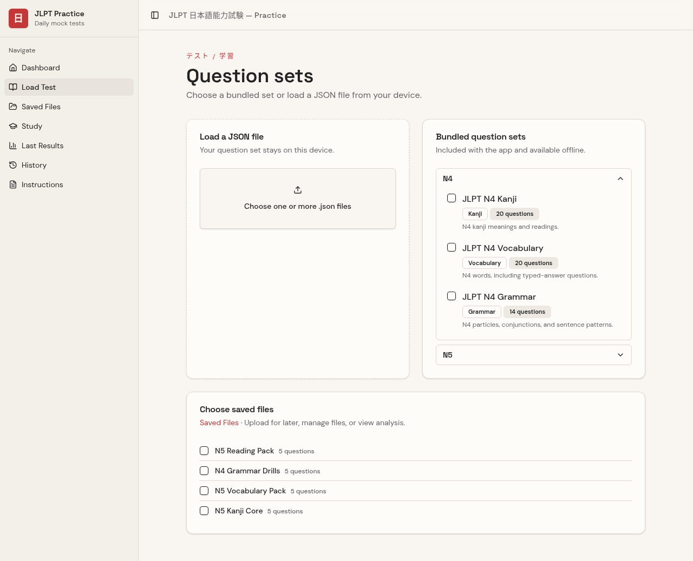
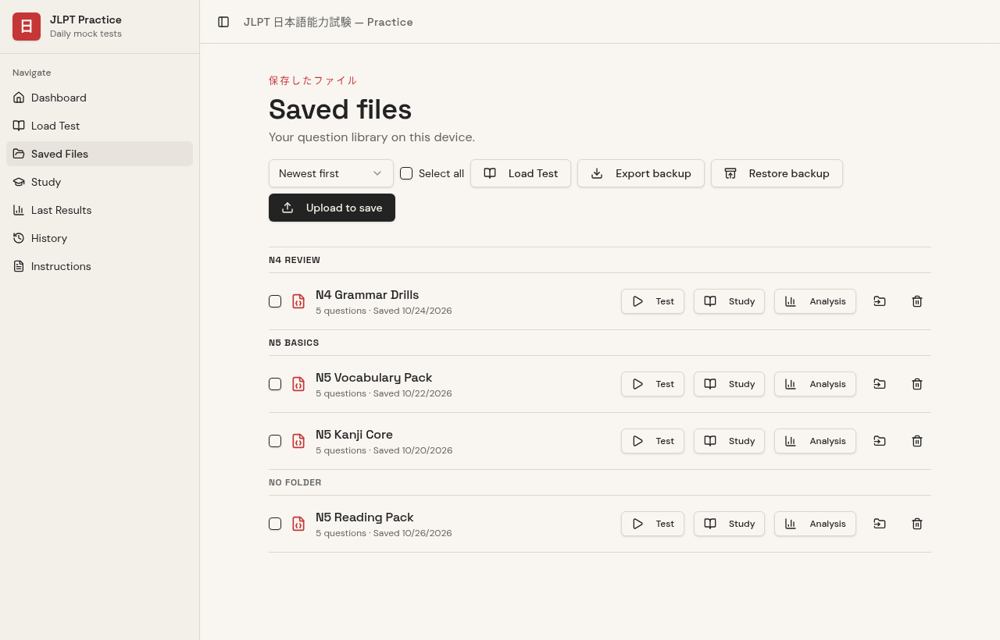
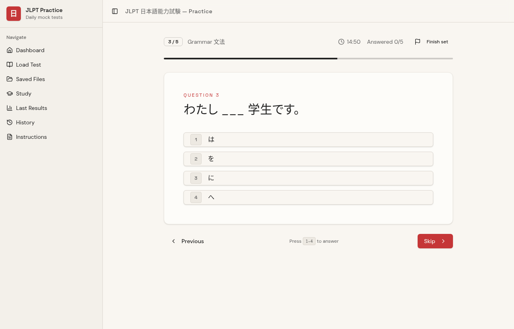
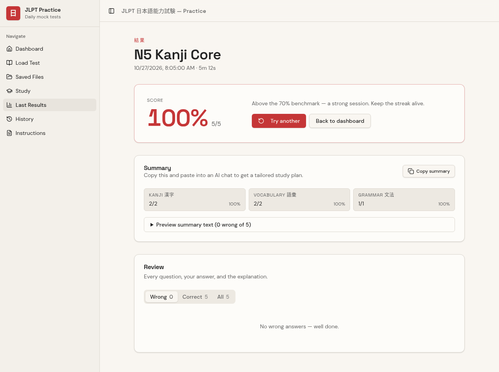
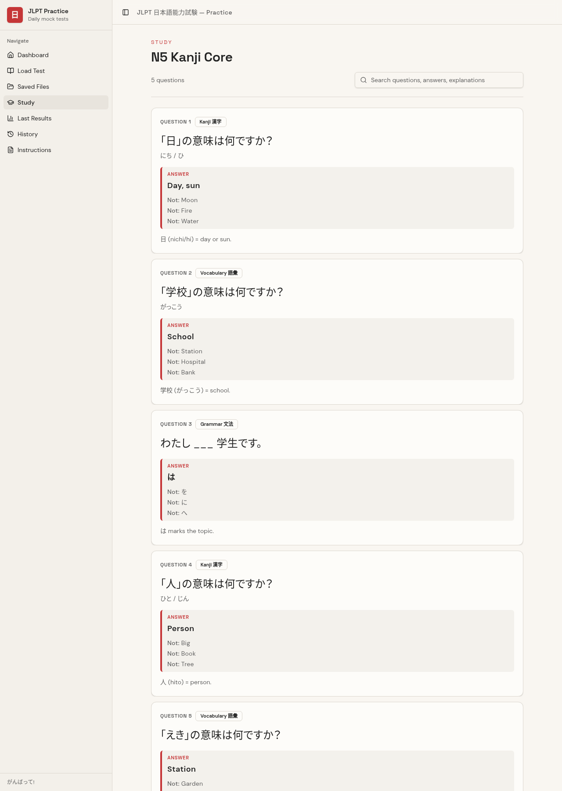
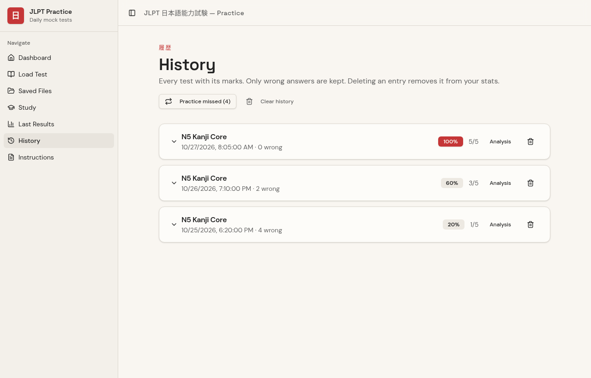
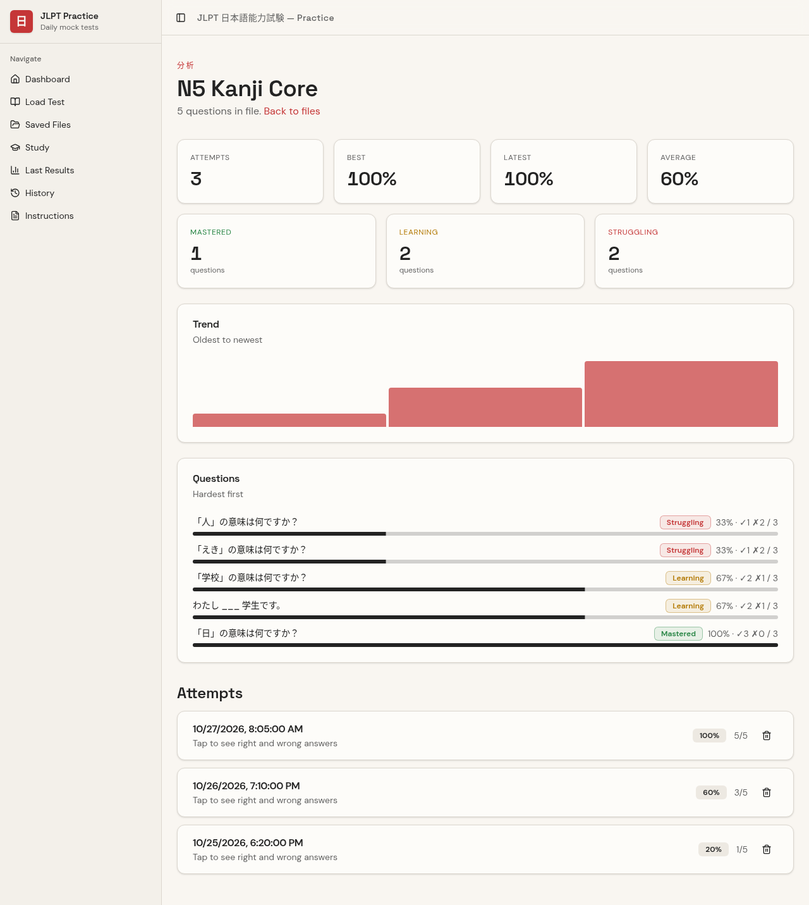
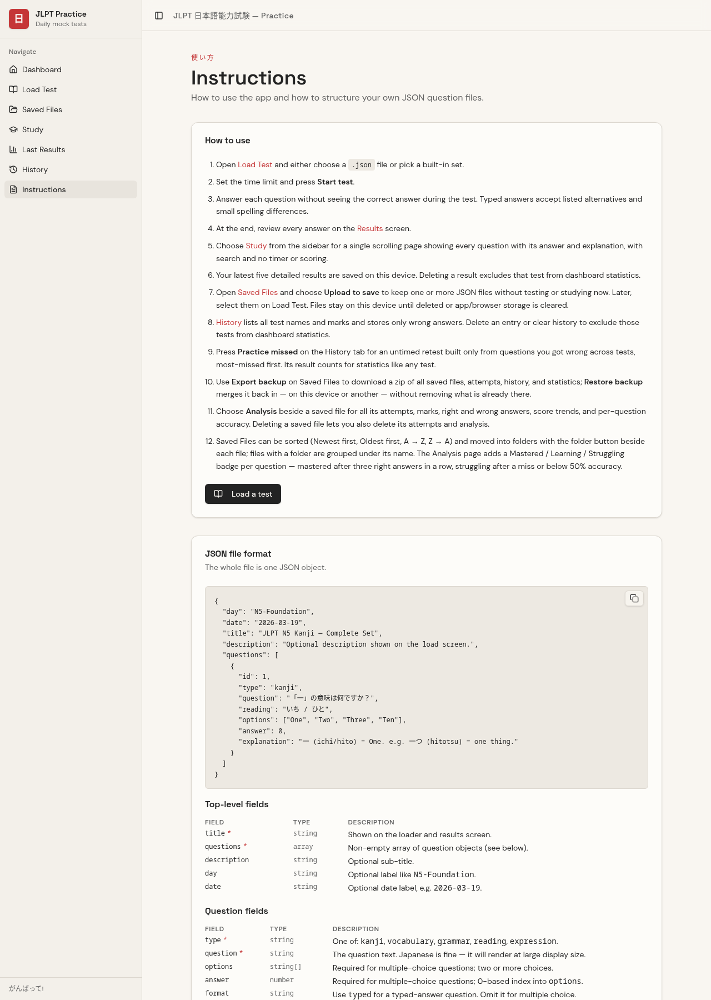

# 🗾 JLPT Practice

A calm, sidebar-driven JLPT (N5–N1) mock-test app with the hush and precision of a Japanese stationery shop. Built with **TanStack Start + React 19 + Tailwind v4**, and packaged as a cross-platform desktop app with **Electron**.



> Paper & Hanko palette · Space Grotesk / DM Sans typography · Sidebar layout

---

## Contents

1. [Features](#features)
2. [Every tab, explained](#every-tab-explained) — with screenshots
3. [Question file format (JSON)](#question-file-format-json) — full specification
4. [Bundled question library](#bundled-question-library)
5. [Backup & restore](#backup--restore)
6. [Run in the browser](#run-in-the-browser-dev)
7. [Run as a desktop app (Electron)](#run-as-a-desktop-app-electron)
8. [Releases via GitHub Actions](#releases-via-github-actions-linux-and-windows)
9. [Project layout](#project-layout)
10. [Resetting progress](#resetting-progress)

---

## Features

- **Daily mock tests** — load any JSON question set, sit a timed or untimed session
- **5 categories** — Kanji (漢字), Vocabulary (語彙), Grammar (文法), Reading (読解), Expression (表現)
- **Configurable timer** — 1–60 minutes per set, or run untimed from Saved Files
- **No-spoiler quiz flow** — answers stay hidden until the end
- **Typed-answer questions** — grade English, Japanese, and other language answers locally against accepted alternatives, with cautious typo tolerance (or `strict` exact matching)
- **Study mode** — a single scrolling, searchable page showing every question with its answer and explanation, no timer or scoring
- **Tabbed review** — Wrong / Correct / All on the results screen, defaulting to Wrong
- **AI-ready summary** — copy a plain-text summary of your last test into any chat to get a tailored study plan
- **Keyboard shortcuts** — `1–4` pick an option, `← / →` navigate, `Enter` confirm
- **Practice statistics** — accuracy, streaks, per-category progress bars; deleted tests are excluded when totals are recalculated
- **Local-only, persistent** — statistics, history, and the last five full results live in `localStorage`; saved JSON files and full per-file attempts live in IndexedDB. No accounts, no cloud.
- **Saved Files library** — upload JSON files without starting anything, sort them (newest / oldest / A→Z / Z→A), group them into folders, run a **Test** or **Study** session straight from each row, or select many at once for bulk move / export / delete
- **File analysis** — every saved file's attempts, right and wrong answers, best/latest/average marks, score trend, and per-question accuracy with a **Mastered / Learning / Struggling** stage per question
- **Practice missed questions** — one button on History builds an untimed retest from the questions you got wrong, most-missed first
- **Backup & restore** — export the whole library (or just selected files) as a zip and merge it back on this or another device

---

## Every tab, explained

The sidebar is the whole app: Dashboard, Load Test, Saved Files, Study, Last Results, History, Instructions.

### Dashboard

Track progress: lifetime accuracy, sessions completed, daily streak, questions answered, per-category bars, and the five most recent full reviews. Deleting a result anywhere removes it from these totals.



### Load Test

Pick bundled sets (grouped by JLPT level, N5 first) and/or upload one or more local JSON files, order them in the queue, choose 10 / 20 / 50 / All questions per set, set the time limit, then **Start test** or **Study sets**. Multiple sets run one after another.



### Saved Files

Your offline question library. Upload to save without starting anything; each row has direct **Test**, **Study**, and **Analysis** buttons. Sort the list, move files into folders (single or batch), select many for bulk export/delete, and export or restore full backups. Deleting a file can optionally delete its attempts and analysis.



### Quiz

The test engine: one question at a time, options picked by click or `1–4` keys, typed answers with hints, timer and progress across the top, and no answers revealed until the end.



### Last Results

The most recent test, tabbed as Wrong / Correct / All (Wrong by default). Every question shows your answer, the correct one, and the explanation, plus a copyable plain-text summary for AI study plans.



### Study

A separate, untimed reference page: every question of the selected set on one scrolling page with answer and explanation, plus full-text search across questions, answers, and explanations.



### History

Every test's name, date, and mark. Each entry stores only its wrong answers; expand to see them. Delete an entry (or clear all) to exclude those tests from statistics, or press **Practice missed** for an untimed retest of everything you've gotten wrong, most-missed first.



### File Analysis (from Saved Files)

Per saved file: attempts, best / latest / average marks, score trend, and a Mastered / Learning / Struggling stage for every question — mastered after three right answers in a row (latest attempts), struggling after a miss on the latest attempt or below 50% accuracy.



### Instructions

The in-app guide repeats the how-to list and the JSON format tables shown above.



---

## Question file format (JSON)

Drop a JSON file into **Load Test** or **Saved Files** (or upload to save for later). The whole file is one JSON object:

```json
{
  "title": "JLPT N5 Kanji — Complete Set",
  "description": "Optional description",
  "questions": [
    {
      "id": 1,
      "type": "kanji",
      "question": "「一」の意味は何ですか？",
      "reading": "いち / ひと",
      "options": ["One", "Two", "Three", "Ten"],
      "answer": 0,
      "explanation": "一 (ichi/hito) = One."
    }
  ]
}
```

A complete reference file — every category, both formats, and every optional field — ships at the project root and in `public/quizzes/` as **`example_structure.json`**.

### Root fields

| Field | Type | Required | Notes |
| --- | --- | --- | --- |
| `title` | string | ✅ | Shown on the loader, results, and history |
| `questions` | array | ✅ | Non-empty array of question objects |
| `description` | string | — | Optional sub-title |
| `day` | string | — | Optional label like `N5-Foundation` |
| `date` | string | — | Optional date label like `2026-03-19` |

### Question types

`type` is required on every question and must be one of:

| Value | Label |
| --- | --- |
| `kanji` | Kanji 漢字 |
| `vocabulary` | Vocabulary 語彙 |
| `grammar` | Grammar 文法 |
| `reading` | Reading 読解 |
| `expression` | Expression 表現 |

### Two question formats

**Multiple choice** (default — include `options` + `answer`):

```json
{
  "id": 7,
  "type": "kanji",
  "question": "Which kanji means “person”?",
  "options": ["人", "大", "天", "本"],
  "answer": 0,
  "explanation": "人 (hito) = person."
}
```

**Typed answer** (`"format": "typed"` + `correctAnswers`):

```json
{
  "id": 2,
  "type": "vocabulary",
  "format": "typed",
  "question": "Translate 学校 into English.",
  "correctAnswers": ["school", "a school", "the school"],
  "explanation": "学校 (がっこう) means school."
}
```

### Question fields

| Field | Type | Required | Notes |
| --- | --- | --- | --- |
| `id` | number \| string | — | Stable identifier (numbers recommended) |
| `type` | string | ✅ | One of the five categories above |
| `question` | string | ✅ | Question text; Japanese renders at display size |
| `options` | string[] | ✅ for MC | Two or more choices; keep the correct one at any index |
| `answer` | number | ✅ for MC | 0-based index into `options` |
| `format` | string | — | `"typed"` for typed questions; omit for multiple choice |
| `correctAnswers` | string[] | ✅ for typed | Accepted answers — add every alternative wording |
| `reading` | string | — | Furigana / reading hint under the question |
| `hint` | string | — | Badge + placeholder for typed answers |
| `strict` | boolean | — | Typed answers must match exactly after normalization (no typo tolerance); default false |
| `explanation` | string | — | Shown in Study and the results review |

### Typed-answer grading

Grading happens entirely on the device. Answers are compared after normalizing Unicode form (NFKC), letter case, spaces, and punctuation. A small typo allowance applies only to longer answers; the app never infers synonyms or meaning — add valid alternatives to `correctAnswers`.

### Automatic repairs on import

Loose JSON from generators is normalized before validation, and the app reports how many fixes it made:

| Fix | Example in | What happens |
| --- | --- | --- |
| Question type | root `"type": "vocabulary"` | Inherited into each question |
| Format aliases | `"format": "mc"`, `"choice"`, `"text"`, `"free"` | Mapped to the canonical two |
| Answer text → index | `"answer": "One"` | Matched against `options` (case-insensitive) |
| Numeric answer | `"answer": "0"` | Converted to an index |
| Typed aliases | `acceptedAnswers`, `answer` as a string, … | Collected into `correctAnswers` |
| Inferred typed format | no `options` but a text `answer` | Treated as typed |

Unknown keys are ignored, not errors. Validation errors say exactly which question and field failed.

---

## Bundled question library

Bundled sets live in `public/quizzes/` and are listed in `public/quizzes/index.json`:

```json
[{
  "id": "n5-vocab",
  "level": "N5",
  "lesson": 2,
  "type": "vocabulary",
  "url": "/quizzes/n5/n5_vocabulary.json",
  "title": "JLPT N5 Vocabulary — Everyday Words",
  "description": "Common N5 words for daily life."
}]
```

| Field | Notes |
| --- | --- |
| `id` | Unique; used for de-duplication |
| `level` | Optional (`"N5"`, `"N4"`, …); sets are grouped by level on Load Test, N-levels first |
| `lesson` | Number; without `level`, groups fall back to lesson, newest first |
| `type` | Question type badge on the loader |
| `url` | Path to the JSON file (also under `/quizzes/…`) |
| `title`, `description` | Display text |

Current bundles: **N5** — Kanji complete set (110), Vocabulary, Grammar; **N4** — Kanji, Vocabulary, Grammar; plus `example_structure.json` (reference only).

Tick several entries to run them one after another, pick 10 / 20 / 50 / All questions per set (a random subset is drawn), and choose **Start test** or **Study sets**. Completed sets count even if you exit between files; finishing early asks whether to save that test to statistics or ignore it.

---

## Backup & restore

**Export backup** on Saved Files zips everything — saved files, full attempts, history, and statistics — with a manifest inside. **Restore backup** merges a zip back in by id: existing entries stay, new ones are added, so restoring twice is safe. When files are selected, **Export selected** saves only those files and their attempts.

Backups travel between devices (e.g. browser → Electron desktop app). Files can also be sorted (newest first, oldest first, A → Z, Z → A) and grouped into folders with the per-file folder button or the bulk "Move to folder" action.

---

## Run in the browser (dev)

```bash
bun install
bun run dev
```

Open <http://localhost:8080>.

Other handy scripts:

```bash
bun run build        # production build (nitro node-server → .output/)
bun run preview      # serve the production build
bun run lint
bun run format
```

---

## Run as a desktop app (Electron)

The app is wired up as an **Electron** desktop shell. The Electron main process lives at `electron/main.cjs`:

- **In dev**, it loads `http://localhost:8080` (the Vite dev server) — full hot reload.
- **In a packaged build**, it spawns the built Nitro node server (`.output/server/index.mjs`) on a free localhost port and points the window at it.

Quiz history, stats, and streaks live in `localStorage`, which Electron scopes to the app's per-user `userData` directory — so your progress persists across launches and updates automatically. Saved JSON files and full attempts live in IndexedDB on the same device.

### Prerequisites

- **Node + Bun** — required for both the web and desktop builds.
- **Linux system libs** — Electron on Pop!_OS / Ubuntu / Debian needs the standard GTK/graphics stack (usually already installed). If Electron fails to launch:
  ```bash
  sudo apt install -y libnss3 libatk-bridge2.0-0 libgtk-3-0 libgbm1 libasound2
  ```

### Develop the desktop app

```bash
bun run electron:dev
```

This starts `bun run dev` and, once the dev server responds on port 8080, opens the Electron window pointing at it. Edits hot-reload just like in the browser.

### Build a desktop package (Linux)

```bash
bun run electron:build
```

Output lands in `electron-release/JLPT Practice-linux-x64/`. Launch it directly:

```bash
./electron-release/"JLPT Practice-linux-x64"/"JLPT Practice"
```

Or archive it for sharing / installing on another Pop!_OS machine:

```bash
tar czf JLPT-Practice-linux-x64.tar.gz -C electron-release "JLPT Practice-linux-x64"
```

To install system-wide, drop the folder under `/opt/` and create a `.desktop` launcher pointing at the `JLPT Practice` binary inside it.

### Windows / macOS

The `electron:build` script targets Linux by default. To build for other platforms, run `electron-packager` with a different `--platform` flag on a machine of that OS (Electron cross-compiles from Linux for `win32`/`darwin`, but code-signing and installer creation are host-OS specific):

```bash
bunx electron-packager . "JLPT Practice" --platform=win32 --arch=x64 --out=electron-release --overwrite --prune=true
bunx electron-packager . "JLPT Practice" --platform=darwin --arch=arm64 --out=electron-release --overwrite --prune=true
```

For a proper `.msi` / `.dmg` installer you'll want `electron-builder` on Windows / macOS respectively.

---

## Releases via GitHub Actions (Linux and Windows)

`.github/workflows/build.yml` builds Linux AppImage and `.deb` packages plus a Windows `.exe` installer, then uploads them directly to GitHub Releases, not Actions artifacts. Push a `v*` tag to trigger it:

```bash
# bump "version" in package.json
git tag v0.1.1
git push origin v0.1.1
```

You can also run **Build Desktop Apps** manually from the repository's Actions tab. Supply a release tag, or leave it empty to use `v` followed by the version in `package.json`. The workflow creates the release if needed and replaces same-named downloads when rerun. Linux and Windows build on their respective GitHub runners using `bun run electron:dist`; downloads appear as each build finishes, not when the workflow first starts.

No secrets needed — the workflow uses the auto-provisioned `GITHUB_TOKEN`.

---

## Project layout

```
.
├── example_structure.json        # annotated reference file: every type, format, and optional field
├── electron/                     # Electron main + preload
│   ├── main.cjs
│   └── preload.cjs
├── docs/screenshots/             # screenshots used in this README
├── public/quizzes/               # bundled question sets + manifest + example_structure.json
│   ├── index.json                # manifest (level, lesson, type, url, title)
│   ├── jlpt_n5_kanji_all.json    # 110 N5 kanji questions
│   ├── n5/                       # N5 vocabulary & grammar
│   └── n4/                       # N4 kanji, vocabulary & grammar
├── src/
│   ├── components/               # UI + shadcn primitives
│   ├── lib/                      # quiz store, types, validation, import, grading, backup, library store
│   ├── routes/                   # TanStack Start file-based routes
│   │   ├── __root.tsx            # app shell + sidebar
│   │   ├── index.tsx             # Dashboard
│   │   ├── load.tsx              # Load Test
│   │   ├── saved-files.tsx       # library: upload, sort, folders, bulk actions, backups
│   │   ├── history.tsx           # marks and wrong answers for every test
│   │   ├── library.$fileId.tsx   # full attempts and per-file analysis
│   │   ├── quiz.tsx              # Active quiz engine
│   │   ├── results.tsx           # Wrong / Correct / All tabs
│   │   ├── study.tsx             # untimed, searchable question review
│   │   └── instructions.tsx      # in-app guide
│   └── styles.css                # Paper & Hanko design tokens
└── .github/workflows/build.yml   # tag/manual Linux and Windows releases
```

---

## Resetting progress

Use **Reset all progress** at the bottom of the Dashboard, or clear Electron's per-app storage:

- Linux: `~/.config/JLPT Practice/`
- Windows: `%APPDATA%\JLPT Practice\`
- macOS: `~/Library/Application Support/JLPT Practice/`

---

## Japanese IME note

Pressing Enter while the IME (e.g. Mozc) is still composing won't submit the answer. The 1–9 keys pick options by physical key, so they work whatever your keyboard layout.

---

がんばって! 🎌
